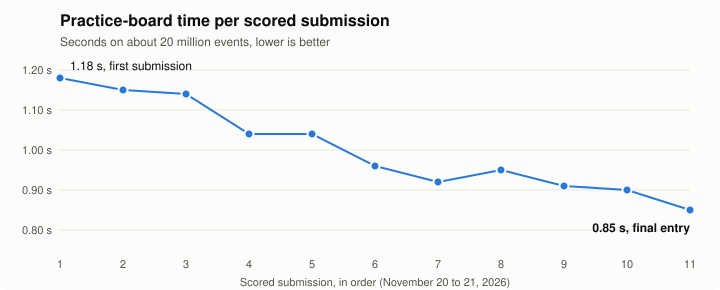

# Shopping Sessions solver

A static Rust binary that reads a folder of messy click-stream CSV files (shop events, ad clicks, identity links and two lookup tables) and writes two exact Parquet tables: `user_daily` and `campaign_daily`. Team BackwardsDeployeds built it for the Databricks Shopping Sessions track of the Builders Buildathon, where the fastest exactly correct run wins.

## The Buildathon

The [Builders Buildathon](https://www.joinbuilders.org/buildathon) ran from November 20 to 22, 2026. Builders, a student-run nonprofit at Ohio State for startups and entrepreneurship, hosted it with an in-person kickoff and closing ceremony on campus and the option to take part fully online. Students from any school could enter, solo or in teams of up to two. Each of its four tracks offered a $5,000 prize, winner take all.

The [Shopping Sessions track](https://www.joinbuilders.org/buildathon/tracks/shopping-sessions), hosted by Databricks, was a speed contest:

- An entry is a public GitHub repository with a Dockerfile at its root. The scorer builds and runs that container on the track's data, and both output tables must match the expected ones exactly.
- The score is the container's run time. Lower wins, and equal times rank the earlier submission first.
- During the event each team could submit twice an hour to a practice board timed on about 20 million events.
- For the final, the chosen commit is rebuilt and timed three times on about 60 million new events, with a 3-minute cap per run.

## Result



- Best practice-board time: 0.85 s, for commit 8981d63, which the team entered as its final. The first submission scored 1.18 s, so the run time fell by 28 percent over the event.
- Before the final, the entered build ran on 60 million generated events with a peak working set of 8.43 GiB and wrote tables identical to those of the previous best build.
- [docs/STATUS.md](docs/STATUS.md) lists all 11 scored submissions and what each one changed.

## Input and output

| Path | Contents |
|---|---|
| `DATA_DIR/manifest.json` | the time window of the dataset |
| `DATA_DIR/products.csv` | product to category |
| `DATA_DIR/campaigns.csv` | campaign to channel |
| `DATA_DIR/links/*.csv` | pairs of user IDs that belong to one person |
| `DATA_DIR/events/*.csv` | views, carts and purchases, with copies, late rows and malformed lines |
| `DATA_DIR/clicks/*.csv` | ad clicks |
| `OUTPUT_DIR/user_daily/` | one row per person and session day: sessions, events, revenue, top category |
| `OUTPUT_DIR/campaign_daily/` | one row per campaign and day: credited, purchasing and assisted sessions, revenue |

`DATA_DIR` defaults to `/data` and `OUTPUT_DIR` to `/output`. `NCPU` sets the thread count; without it the binary uses every core it can see. [CONTEXT.md](CONTEXT.md) defines each term (person, session, credit, assist, late event).

## How it works

1. Every CSV file is memory-mapped and cut into 2 MiB chunks that threads scan in parallel. A tokenizer finds commas, quotes and line ends 64 bytes at a time with SIMD bitmasks and drops malformed lines exactly as the track rules require.
2. User IDs of up to 10 characters pack into one 64-bit key whose order matches byte order; longer or unusual IDs are interned.
3. Links merge user IDs into persons with union-find; each person is named by its byte-wise smallest ID.
4. Events are spread over buckets by event ID, so each group of copies is deduplicated and validated in one place; the surviving events then move to per-person buckets.
5. Each person's events fall into 30-minute slots, and sessions are cut between consecutive occupied slots that are not neighbors or whose facing events are more than 30 minutes apart, so no event sort is needed. Each session is credited to the latest valid click in the 7 days up to its start, or to `organic`, and campaign assists are counted from the same clicks.
6. Each thread writes its own `user_daily` Parquet file a row group at a time between buckets; `campaign_daily` is written as one part per thread, all at once.

## Correctness checks

| Check | Command |
|---|---|
| Unit tests, including tokenizer cases at every chunk boundary | `cargo test --release --locked` |
| Every case in `fixtures/` against its expected tables | `python3 scripts/run_fixtures.py fixtures -- target/release/solver` |
| The published dev set against the published answer | `make run-dev check-dev` |
| Generated datasets from many seeds against the Python reference in `scripts/reference.py` | `python3 scripts/differential.py GENERATOR SOLVER OUT_DIR SEED...` |

## Build and run

`make build` builds the Docker image for linux/amd64, `make test` runs the unit tests and `make fixtures` runs every fixture case through the image.

```sh
make build
make test
make fixtures
cargo build --release --locked
DATA_DIR=path/to/data OUTPUT_DIR=path/to/output target/release/solver
```

The image starts `FROM scratch` and holds one static musl binary, built for `x86-64-v3` with fat LTO and the mimalloc allocator.

## Layout

- `src/`: one module per stage (`scan`, `dialect`, `lookups`, `ids`, `links`, `people`, `events`, `clicks`, `timestamp`, `sessions`, `output`)
- `scripts/`: run, compare and differential-test helpers
- `fixtures/`: small cases with expected tables
- `docs/adr/`: design decisions
- `CONTEXT.md`: the domain vocabulary
- `opt/*` branches: experiments, candidate builds and merge staging; [docs/STATUS.md](docs/STATUS.md) names the scored commits

## License

MIT. See [LICENSE](LICENSE).
